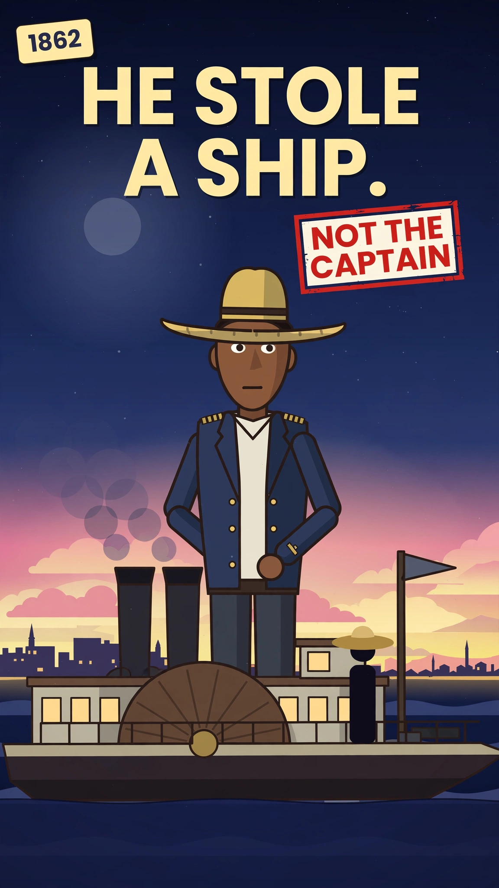

# Robert Smalls — "He Wore the Captain's Hat and Took a Confederate Ship"

**Video:** [`video.mp4`](video.mp4) — the finished Short, in this folder
**Also on YouTube:** https://youtube.com/shorts/ygtEc3lQHyc
**Length:** 68.6 seconds · 7 scenes · **Published:** 24 November 2026, 11:30 PM IST
**Thumbnail text:** HE STOLE A SHIP

## Description

Before dawn on May 13, 1862, Robert Smalls — a 23-year-old enslaved crewman — took the Confederate steamer Planter out of Charleston Harbor, past Fort Sumter, and delivered it to the Union blockade. Sixteen people escaped to freedom that morning. Smalls later piloted for the Union and served five terms in the U.S. House of Representatives (1875–1887).

## The story in 60 seconds

Smalls, a crewman on the Confederate transport steamer Planter, waits until the white officers go ashore for the night, puts on the captain's hat, and steers the ship out of Charleston Harbor — past Fort Sumter, giving the correct signals — to the Union blockade. Sixteen people are aboard. He hands the ship to the Union, pilots for them through the war, and later serves five terms in Congress. End card: ROBERT SMALLS, 1839–1915.

## Facts checked

- Died February 23, 1915, Beaufort, South Carolina.
- Sixteen people in all: 8 men, 5 women, 3 children (Flag-Officer Du Pont's count).
- Who was at the wheel is disputed — the script takes no side.

Sources: National Park Service; HistoryNet; Biographical Directory of the U.S. Congress.

## Hashtags

#RobertSmalls #AmericanHistory #CivilWar #BlackHistory #HistoryShorts

## Files

- `video.mp4` — the finished 68.6-second Short (1080x1920).
- `script.md` — the approved 198-word script and 7-scene storyboard.
